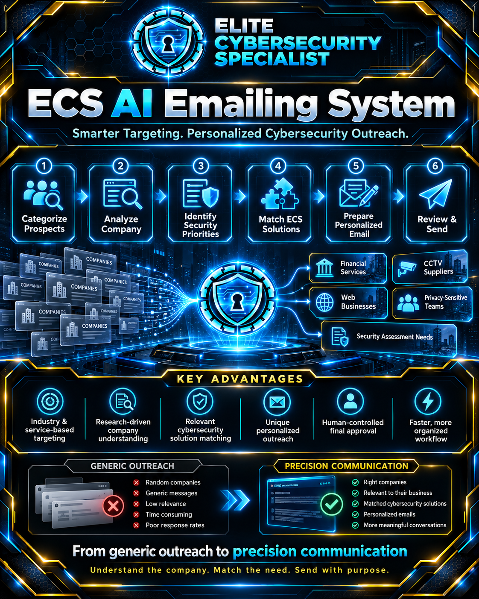
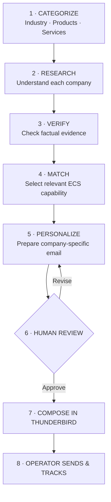

<p align="center">
  
</p>

<h1 align="center">ECS AI EMAILING SYSTEM</h1>

<p align="center"><strong>ELITE CYBERSECURITY SPECIALIST · MALAYSIA</strong></p>

<p align="center"><strong>Understand Businesses. Identify Relevant Needs. Communicate with Precision.</strong></p>

<p align="center">
  <a href="https://github.com/elite-cybersecurity-specialist/company-profile"><strong>Company Profile</strong></a> ·
  <a href="https://github.com/elite-cybersecurity-specialist"><strong>Other ECS Projects</strong></a> ·
  <a href="https://www.linkedin.com/company/elite-cybersecurity-specialist/"><strong>LinkedIn Company</strong></a> ·
  <a href="mailto:Yuhisern@protonmail.com"><strong>Contact ECS</strong></a>
</p>

> [!IMPORTANT]
> **PUBLIC PRODUCT OVERVIEW — SOURCE CODE NOT PUBLISHED IN THIS REPOSITORY AT THIS STAGE.**  
> This repository describes the ECS AI Emailing System, its intended workflow, and its engineering boundaries. It does not contain the private application, client/prospect records, account credentials, or email history. The system assists with research and drafting; the operator reviews and manually sends emails.

---

## Contents

- [Executive Overview](#executive-overview)
- [The Problem with Conventional Outreach](#the-problem-with-conventional-outreach)
- [The ECS Difference](#the-ecs-difference)
- [How the System Works](#how-the-system-works)
- [Cybersecurity Targeting Examples](#cybersecurity-targeting-examples)
- [Why This Approach Matters](#why-this-approach-matters)
- [Human Control, Evidence and Privacy](#human-control-evidence-and-privacy)
- [Development and Verification](#development-and-verification)
- [Repository Scope](#repository-scope)
- [Company Information and Contact](#company-information-and-contact)

---

## Executive Overview

**ECS AI Emailing System** is an in-house, AI-assisted business outreach preparation system developed by **ELITE CYBERSECURITY SPECIALIST (ECS)**.

Its defining purpose is **precision targeting**: organize prospective organizations by their industries, products and services; understand each company's business context; consider its potential cybersecurity priorities; match relevant ECS capabilities; and prepare **a distinct, company-specific email** for human review.

**The goal is not to send more generic emails. The goal is to communicate relevant cybersecurity solutions to better-matched organizations.**

The system is designed around a critical distinction: a prospect's industry may suggest a **possible** security requirement, but it is not evidence that a vulnerability exists. Public research supports thoughtful outreach; confirmed findings require a separate, authorized assessment.

## The Problem with Conventional Outreach

| Common outreach limitation | ECS system approach |
|---|---|
| Manually researching one company after another | Structured prospect records and research assistance |
| Unorganized contact lists | Categorization by sector, products, and services |
| Sending the same offer to unrelated businesses | Select a cybersecurity proposition relevant to each company |
| Weak understanding of a recipient's operation | Record and verify company-specific business context |
| Repeatedly writing similar emails | Generate editable, personalized drafts |
| Difficult-to-track follow-ups or repeated contacts | Local prospect tracking and duplicate / opt-out safeguards |

These are **workflow design differences**, not claims of independently measured conversion rates, response-rate improvements, or time savings.

## The ECS Difference

ECS looks at what each prospective customer **supplies, operates, or protects** before deciding which service to discuss.

A financial organization, CCTV supplier, website operator, and privacy-sensitive professional do not have identical security needs. The system helps the operator identify an appropriate conversation for each, rather than sending a generic catalogue of every ECS service.

**One business category does not mean one identical email.** Companies in the same sector can have different products, customers, infrastructure, and priorities. Their communications should reflect those differences.

## How the System Works



1. **Categorize potential clients.** Record companies by business sector and the products and services they offer.
2. **Research the individual company.** Examine relevant publicly available business information through the guided workflow.
3. **Validate evidence.** Separate verified company facts from possible security requirements and untested assumptions.
4. **Match ECS services.** Select a relevant and appropriately available cybersecurity capability.
5. **Prepare a unique email.** Draft a message grounded in the specific company and the cybersecurity conversation ECS can reasonably offer. Optional AI assistance supports this step; local drafting is also available.
6. **Review and approve.** The operator checks the recipient, research, claims, service suitability, and email wording.
7. **Compose and send manually.** The software prepares a Thunderbird compose window; the operator checks it and clicks Send.
8. **Track outcomes.** Maintain status, replies, follow-ups and do-not-contact controls in the local workspace.

> [!NOTE]
> The operator can prepare emails in succession. A fixed waiting period between Compose actions is **not** a guaranteed way to prevent spam filtering, provider throttling or account restrictions. Responsible sending practices, recipient relevance, and applicable rules still apply.

## Cybersecurity Targeting Examples

The examples below illustrate **potential solution matches**, **not confirmed weaknesses at any specific company**.

| Prospective customer category | Relevant ECS service conversation |
|---|---|
| **Financial and payment services** | Security hardening for servers, web servers, administrative/GUI workstations, networks and payment-support infrastructure |
| **CCTV suppliers and integrators** | CCTV camera, recorder, video management, remote administration and supporting network hardening |
| **Businesses needing stronger websites** | Security-first website development, protected administration, hardened hosting and web application security |
| **Privacy-sensitive teams and professionals** | Custom secure Android devices, mobile hardening, identity separation and protected communications |
| **Organizations requiring security assurance** | Authorized penetration testing, evidence-based vulnerability validation, remediation and re-testing |

**Illustrative example:** A company selling CCTV installations might receive an email about strengthening camera-management infrastructure. Another company providing digital payment services might receive a separate message about hardening administrative access and its interconnected systems. Each draft is tailored to the recipient's **verified business context**, not just the category label.

## Why This Approach Matters

- **Relevant audience selection:** Prioritize businesses that plausibly benefit from the services offered.
- **Better business context:** Explain why a particular cybersecurity subject is relevant to the recipient.
- **Company-specific communication:** Adapt the message to an individual organization's products and operations.
- **Less repetitive preparation:** Reuse structured research and drafting workflows while preserving review.
- **Evidence discipline:** Avoid implying that public-business research proves a security weakness.
- **Operator accountability:** Keep outreach decisions and actual email transmission under human control.

**Research with purpose. Match with relevance. Communicate with precision.**

## Human Control, Evidence and Privacy

- **No autonomous bulk sending.** The system prepares drafts; humans decide whether and when to send them.
- **No unapproved security testing.** Identifying a possible service need does not authorize penetration testing or prove a vulnerability.
- **Source-led claims.** Company-specific statements should be supported by attributable information and operator checks.
- **Local-first records.** Private prospective-company information, drafts, settings and attachments are not published here.
- **Opt-out and duplicate awareness.** Operators remain responsible for maintaining appropriate suppression controls and honoring applicable outreach and email-provider policies.
- **Service readiness.** The operator must ensure that ECS can genuinely provide the capability being offered.

## Development and Verification

**Documented snapshot:** Audited R5, 23 October 2026. The internal audit recorded **58 automated regression tests passing** and packaged-source checksum verification. These checks cover the tested release and **do not establish** that every workflow, AI provider integration, or external email-delivery path has been validated.

**Not independently established:** live Thunderbird delivery across different desktops, live AI-provider behavior, customer security conditions, reduced outreach time, or improved campaign response rates.

This public repository is an explanatory project page. Its presence does not mean the software has been released for public installation or that the private ECS prospect workspace is available.

## Repository Scope

This initial publication deliberately contains only the project overview and public ECS images:

```text
precision-email-system/
├── README.md
├── email-system.png
├── ECS_Digital_Name_Card_525x295.png
└── .gitignore
```

**The private application, the 500-company internal workspace, backups, operational configuration, and audit archive are not part of this publication.** Any future release of source code should be separately reviewed, sanitized, licensed, and verified before publication.

---

## Connect with Elite Cybersecurity Specialist

**Yuhisern Navaratnam** — Cybersecurity Engineer  
**Elite Cybersecurity Specialist** | Malaysia  
**SSM:** 202403184091 (MA0319303-P)

<p align="center">
  <a href="https://raw.githubusercontent.com/elite-cybersecurity-specialist/battle-hardened-ai/main/assets/ECS_Digital_Name_Card_525x295.png">
    
  </a>
</p>

- **Email:** [Yuhisern@protonmail.com](mailto:Yuhisern@protonmail.com)
- **WhatsApp:** [+60 17-279 1717](https://wa.me/60172791717)
- **GitHub — Company Profile:** [Official repository](https://github.com/elite-cybersecurity-specialist/company-profile)
- **GitHub — Battle-Hardened AI:** [Official repository](https://github.com/elite-cybersecurity-specialist/battle-hardened-ai)
- **GitHub — Other Cybersecurity Projects:** [Elite Cybersecurity Specialist](https://github.com/elite-cybersecurity-specialist)
- **TikTok:** [@yuhisern](https://www.tiktok.com/@yuhisern)
- **LinkedIn:** [linkedin.com/in/yuhisern](https://www.linkedin.com/in/yuhisern)
- **X:** [x.com/yuhisern](https://x.com/yuhisern)
- **LinkedIn — ECS Company:** [Elite Cybersecurity Specialist](https://www.linkedin.com/company/elite-cybersecurity-specialist/)
- **Official ECS Blog:** [ECS Cybersecurity Articles](https://elite-cybersecurity-specialist.blogspot.com)

<p align="center"><strong>HARDEN. TEST. VERIFY. IMPROVE.</strong></p>

<p align="center"><em>ECS AI Emailing System — Precision Customer Intelligence and Human-Controlled Cybersecurity Outreach.</em></p>
